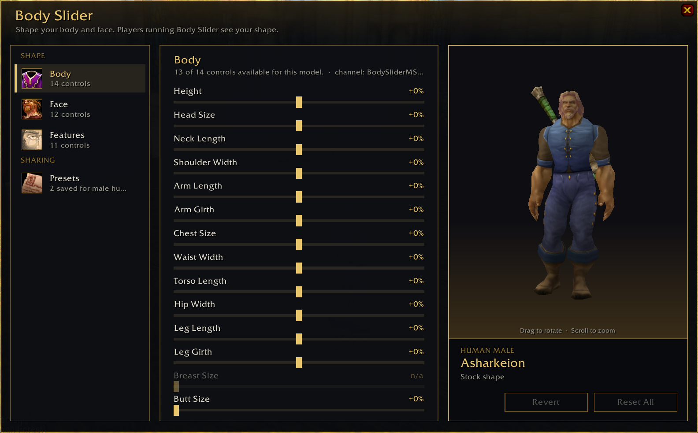
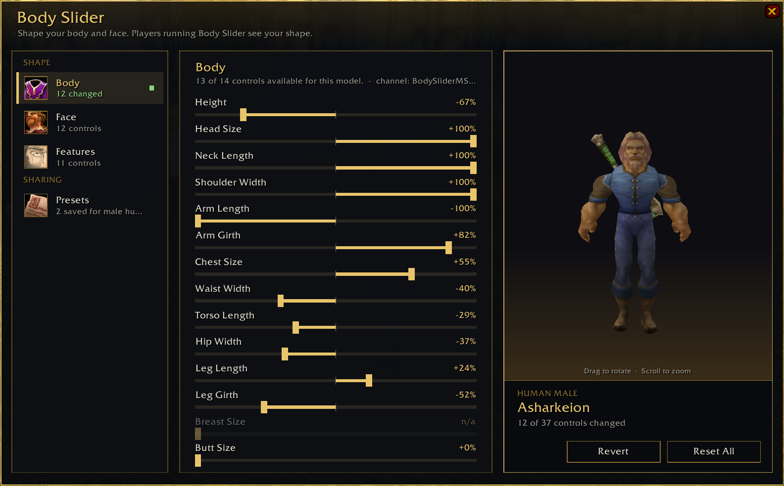
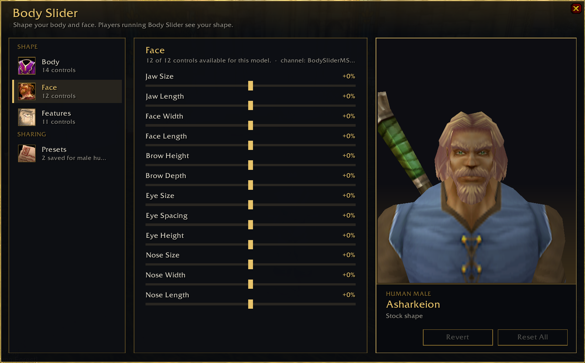
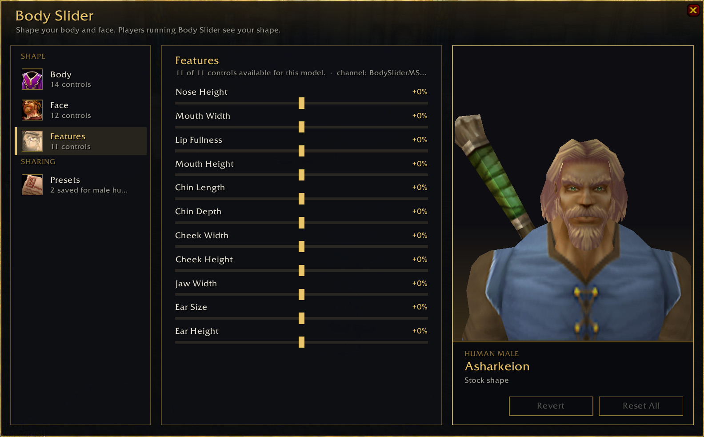
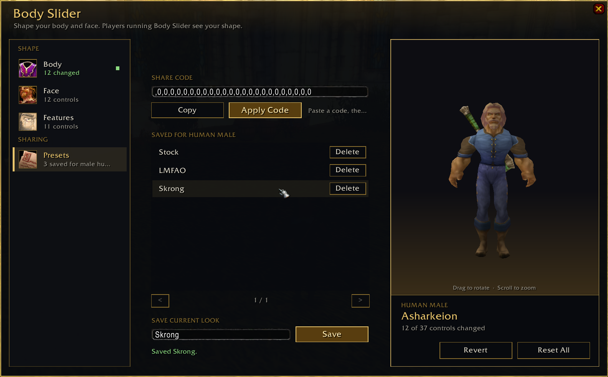

<div align="center">

# 🎚️ Body Slider

**Shape your body and face in stock World of Warcraft 3.3.5a — and let other players see it.**

[-0070dd?style=for-the-badge&logo=battledotnet&logoColor=white)](#-install)
[](Interface/AddOns/BodySlider/BodySlider.toc)
[](#-verification--remaining-acceptance)
[](#-what-you-can-shape)
[](LICENSE)

[](#-build-from-source)
[](native)
[](Interface/AddOns/BodySlider)
[](#-verification--remaining-acceptance)
[](CMakeLists.txt)
[](#-how-it-works)



</div>

---

## ✨ Highlights

- 🧍 **37 controls** — 14 body, 12 face and 11 feature sliders, including breast/butt deformation.
- 👁️ **Live 3D preview** of your own character that reshapes as you drag. Drag to rotate, scroll to zoom.
- 💾 **Presets** saved per race and sex, plus copy‑and‑paste **share codes**.
- 🌐 **Multiplayer sharing** over a channel, party/raid or whisper — other Body Slider users see your shape.
- 🛡️ **Non‑destructive** — your original `Wow.exe` is never modified and can be restored byte‑for‑byte.
- 🧩 **Client‑only** — no server changes, custom packets, GlueXML, DBC edits or model replacements.

## 📸 Screenshots

<table>
  <tr>
    <td width="50%"><p align="center"><b>Body</b> — sliders fill outward from zero</p></td>
    <td width="50%"><p align="center"><b>Face</b> — jaw, brows, eyes, nose; preview zooms to the head</p></td>
  </tr>
  <tr>
    <td width="50%"><p align="center"><b>Features</b> — mouth, chin, cheeks, ears</p></td>
    <td width="50%"><p align="center"><b>Presets</b> — share codes and saved looks</p></td>
  </tr>
</table>

## 🎛️ What you can shape

| Page | Controls |
| --- | --- |
| **Body** (14) | Height, head size, neck length, shoulder width, arm length/girth, chest, waist, torso length, hip width, leg length/girth, breast size *(female)*, butt size |
| **Face** (12) | Jaw size/length, face width/length, brow height/depth, eye size/spacing/height, nose size/width/length |
| **Features** (11) | Nose height, mouth width/height, lip fullness, chin length/depth, cheek width/height, jaw width, ear size/height |

Right‑click a slider to reset it; the mouse wheel nudges it. **Revert** returns to how things were when you opened the window, **Reset All** returns to stock.

<details>
<summary><b>Model coverage and limits</b></summary>

There are audited skeletal profiles for the twenty original race/sex models.
Filename, bone count, key table, every parent and every bind pivot must match;
unrecognized skeletons, shapeshifts and HD replacements are left alone.
Breast deformation is enabled on female profiles; butt and facial controls apply to both sexes.

Breast/butt and face controls reshape each character's own vertices and normals.
Their smooth local regions are estimated from the original body mesh and skeleton
landmarks. They are not copied Retail mesh profiles. Recognized raw meshes and
software‑remapped variants have recorded vertex fingerprints; unknown geometry
is left unchanged. One malformed Human Female software LOD variant is excluded.
These geometry checks do not establish visual quality for every animation,
outfit, mount or race. HD/replacement models require their own calibration.

</details>

## 📦 Install

> [!IMPORTANT]
> Close the client and keep a copy of your original executable first.

1. Run `BodySliderPatch.exe` and select your supported original `Wow.exe`. It creates `Wow-BodySlider.exe` beside it and leaves the original unchanged. It refuses unknown executables and existing output files.
2. Keep the original as a backup, rename the patched copy to `Wow.exe`, and put `BodySlider.dll` beside it.
3. Copy `Interface/AddOns/BodySlider` into the client's `Interface/AddOns`.
4. Enable **Body Slider** in the character‑select AddOns list, log into the world and type **`/bodyslider`**.

> [!NOTE]
> There is no slider UI before entering the world. Appearance changes are local and visual only — reach, movement, combat and collision stay server‑controlled.

### Uninstall

Restore the original executable (see below) and remove the addon and DLL. Keep the DLL installed until the client is closed. The WTF SavedVariables file can be kept as a preset backup.

## 🌐 Sharing with other players

Everyone who should see shapes needs the patch, DLL and addon; others see ordinary models. Settings persist per realm and character. Sharing defaults to the custom `BodySliderMSP` channel, and both players must use the same transport:

| Command | Transport |
| --- | --- |
| `/bodyslider channel` | Joins `BodySliderMSP` and sends channel chat carrying the MSP `BS` field. Wire messages are hidden from your chat window. **Not private or encrypted.** |
| `/bodyslider group` | Sends MSP addon messages over your party or raid. |
| `/bodyslider whisper` | Original MSP whisper transport, for compatibility with earlier versions where the server allows it. |
| `/bodyslider status` | Reports the selected transport and whether it is ready or paused. |

<details>
<summary><b>Transport behaviour and protocol details</b></summary>

Channel/group broadcasts coalesce changes to at most one send per three seconds,
with a thirty‑second heartbeat. Channel joining has three bounded attempts;
explicit server rejection pauses the transport for the session. Unresolved names
such as `Unknown` never become whisper recipients. No transport automatically
falls back to whispers. Use a transport command to retry after resolving a block.
Servers can restrict channels and group messages independently; joining a channel
does not remove those restrictions. The original server warning remains visible.

The `BS` field and `BodySlider/2:` value schema are unchanged. `BS` remains an
experimental, unregistered MSP field; normal MSP whisper framing is used in
whisper mode. Group mode carries the same field over addon messages, and channel
mode wraps it in a printable Body Slider envelope rather than claiming standard
MSP whisper interoperability. The decoder still accepts twelve‑control
`BodySlider/1:` values, treating new controls as zero. See
[MSP.md](Interface/AddOns/BodySlider/MSP.md) for framing and limits. Incoming
settings are bound to game‑observed sender names and GUIDs, never a GUID from
the network payload.

Share codes on the Presets page are the same `BodySlider/2:` string the MSP field
carries, and presets are stored per race and sex in `BodySliderDB.presets`.

</details>

> [!WARNING]
> This does not circumvent a realm's integrity checks or rules on modified clients. Launcher replacement, anti‑cheat acceptance and message delivery depend on the realm — there is no universal server compatibility claim.

## ⚙️ How it works

```text
Wow.exe (original, untouched) ──► BodySliderPatch.exe ──► Wow.exe (patched loader)
                                                              │
                                                              ▼
                                       BodySlider.dll ◄──► BodySlider addon (/bodyslider)
```

A small executable loader patch loads `BodySlider.dll`, which hooks skeleton and skinning code in memory. The in‑game addon provides the UI, presets and sharing. Missing DLL: stock startup continues. Unknown executable or conflicting hook: the DLL refuses to install and logs why to `BodySlider.log` beside the executable.

<details>
<summary><b>Technical details</b></summary>

The loader updates PE header fields and adds a 212‑byte
bootstrap in a new section plus restoration metadata. Original code, resources,
and imports remain byte‑identical. It loads only the `BodySlider.dll` beside the
executable and invokes initializer export ordinal 1 before stock startup, after
Windows has completed DLL initialization. The DLL installs eleven in‑memory hooks:
the original four Lua/skeleton/lifecycle hooks plus batch vertex binding, five
CPU skinning routines and shadow batches. Hardware skinning uses a private vertex
buffer per shaped character; software skinning reads an immutable private vertex
snapshot through temporary model‑data views. Shadow groups split when different
instances have different shapes. Engine‑owned vertices and class layouts remain
unchanged. Mesh buffers rebuild after device invalidation and are released on
reset or model destruction.

Six Lua entry bridges use verified compiler padding inside the executable's
original `.text` section. Stock Lua rejects DLL callback addresses directly;
these bridges preserve its validator and check code unchanged. A harmless startup
Lua call verifies the callback path before a character login.

The preview calls `BodySlider_Set(previewFrame)` each frame; DLL 0.3.0 shapes that
PlayerModel with the local player's values, older DLLs leave it stock.

The separate projected‑texture rendering helper still uses original geometry;
decal alignment may differ on reshaped surfaces.
Patching invalidates the original executable signature; restoration recovers it.

This is a standalone repository: native DLL source, native patcher source and
embedded patch data, addon, generated model profiles, audit generators, tests and
packaging tools. Generated model headers are included, so building does not
require game data or StormLib.

</details>

## 🛠️ Build from source

**Requires:** Windows, MSVC C++ with x86 tools / Windows SDK, CMake and Python 3.
Users do not need Python or a compiler — the patcher is a small native EXE, and the DLL statically links the C++ runtime and imports only Windows system APIs.

```powershell
cmake -S . -B build -A Win32
cmake --build build --config Release
ctest --test-dir build -C Release --output-on-failure
build/patcher/Release/BodySliderPatch.exe --patch path/to/original/Wow.exe path/to/new/Wow.exe
New-Item -ItemType Directory -Force dist
python package.py dist/BodySlider-0.3.0-prototype.zip
```

Copy `build/native/Release/BodySlider.dll` beside the generated executable and install the addon.

> [!CAUTION]
> The patcher accepts customized WoW 3.3.5.12340 executables, including renamed clients, and refuses to overwrite existing output. It validates the PE layout and resolves loader imports from the selected file. Patching support does not guarantee the DLL hooks are compatible with a realm's custom code.

**Restore** a byte‑identical original executable at a new path:

```powershell
BodySliderPatch.exe --restore path/to/patched/Wow.exe path/to/restored/Wow.exe
```

## 🧪 Verification & remaining acceptance

```powershell
python -m pip install -r requirements-dev.txt
$env:BODYSLIDER_STOCK_EXE = 'C:/Games/WoW-original/Wow.exe'
python -m unittest discover -s . -p 'test_*.py' -v
python patcher-native/test_native_patcher.py
python Interface/AddOns/BodySlider/test_protocol.py
```

<details>
<summary><b>Test dependencies and audit regeneration</b></summary>

Patcher optional disassembly checks use `pefile` and `capstone`; Lua tests use
`lupa.lua51`. Runtime dependencies are not shipped inside the addon. Model‑audit
tests use the recorded JSON; recreating the audit reads local MPQs with StormLib.
Tests that inspect a real executable use `BODYSLIDER_STOCK_EXE` (or an ignored
`local/Wow.exe`) and skip with an explicit reason when it is unavailable.
`BODYSLIDER_PATCH_EXE` can override the built native patcher path.

Audit regeneration is optional and requires your own original client data and
64‑bit StormLib DLL. Neither is distributed in this repository. Pass them
explicitly; the tools have no paths into another checkout:

```powershell
python model_audit.py C:/Games/WoW --stormlib C:/Tools/StormLib.dll --output local/stock_profiles.json --header local/StockProfiles.h
python deform_audit.py C:/Games/WoW --stormlib C:/Tools/StormLib.dll --output local/deform_profiles.json --header local/DeformProfiles.h
python test_deform_audit.py --mesh-fixtures build/deform-fixtures --client C:/Games/WoW --stormlib C:/Tools/StormLib.dll
build/native/Release/BodySliderDeformTest.exe build/deform-fixtures
```

Create the ignored `local` directory before generating audit output there. The
archived evidence files and audit JSON retain historical source locations as
provenance; these are not build inputs or required runtime locations.
See `evidence-native.txt`, `evidence-mesh.txt`, `stock_profiles.json` and
`deform_profiles.json` for source identities and offline ABI/model evidence.
Historical validation records in [VALIDATION.md](VALIDATION.md) retain earlier milestone labels and limitations.

</details>

### Live acceptance checklist

- [ ] Slider changes and reset on each supported race/sex; feet, equipment, mounts, movement/combat animations and shapeshift return remain usable.
- [ ] Two clients seeing each other's settings, later arrival, departure, reset, UI reload and relog on an unchanged server.
- [ ] Actual TRP3/MSP‑addon coexistence (protocol simulations alone do not prove it).
- [ ] Clean client exit, crowded‑area performance and each target realm's acceptance.

<div align="center">

**The package is a prototype until those checks are recorded as passed.**

</div>

## 📄 License

Released under the [MIT License](LICENSE). World of Warcraft is a trademark of Blizzard Entertainment; this project is not affiliated with or endorsed by Blizzard.
